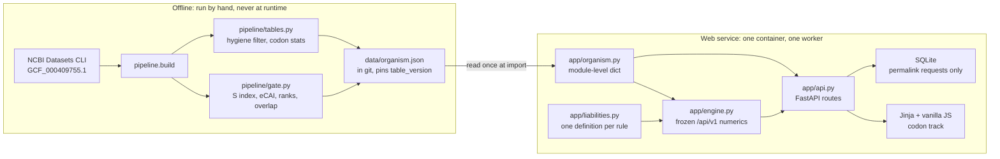
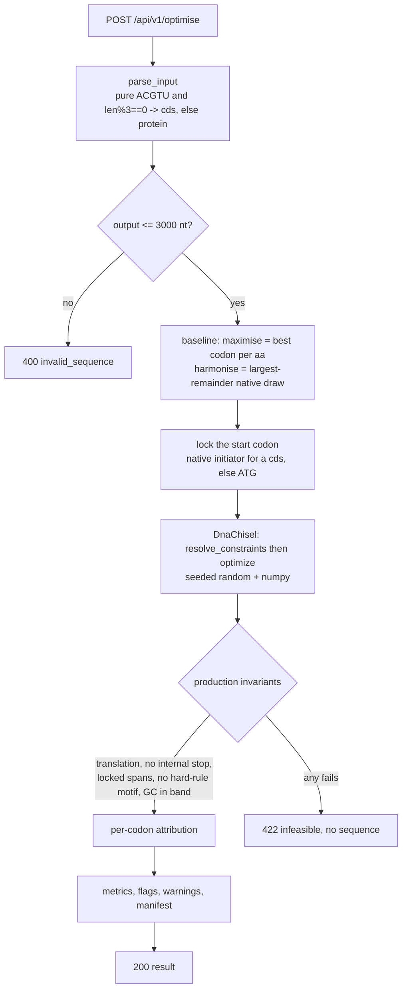
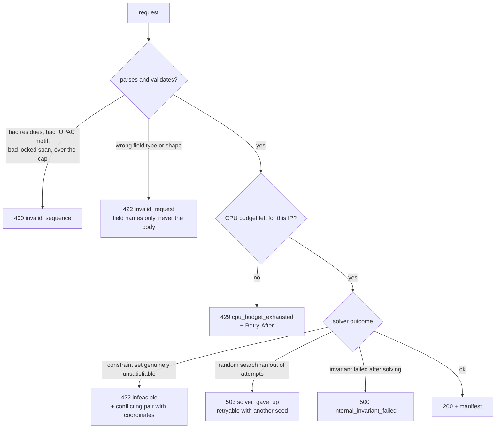
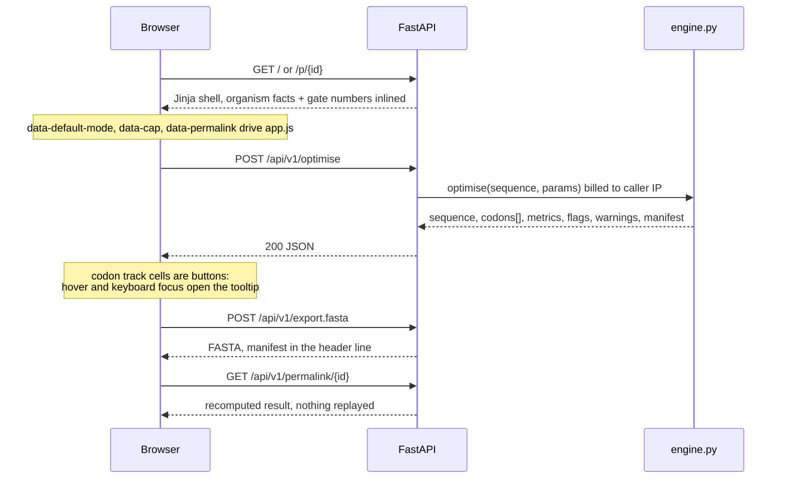
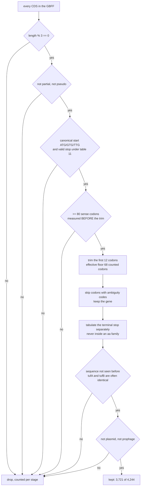
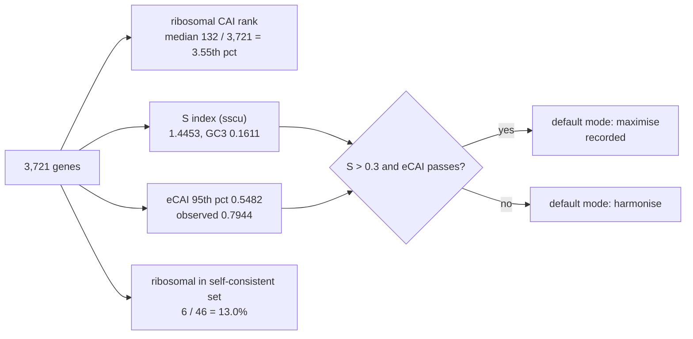
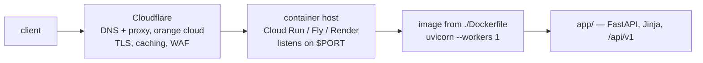

# codon-optimiser

Codon optimiser for **Clostridium butyricum DSM 10702** (RefSeq `GCF_000409755.1`,
taxid 1316931, NCBI translation table 11, 28.4992% genomic GC).

Paste a protein or a coding sequence, get a DNA coding sequence plus a per-codon
explanation of why each codon was chosen. The explanation is the product; the
sequence is commodity.

Conventions, recorded gate numbers and hard rules live in `Claude.md`. Read that
first; this file says how the pieces fit and how to run them.

## How it fits together

Two halves that never blur. The pipeline is run by hand and writes one file; the
service reads that file at import and never touches the pipeline again.

`liabilities.py` holds each rule exactly once and is used three ways: to configure
the solver, to explain which rule forced a codon, and to assert in production that
the returned sequence violates nothing.

## Layout

    pipeline/   offline, run by hand, writes data/organism.json and stops
    app/        the web service: reads data/organism.json at import, nothing else
    data/       organism.json (in git); permalinks.sqlite (not in git)
    tests/      control, round-trip, determinism, API contracts

## What one request does

Per-codon attribution is a whole-sequence test, not a local one: the rejected codon
is put back and the *entire* sequence is rescanned, because a 20 bp direct repeat's
partner copy can sit anywhere. A local-window scan mislabels constraint-forced
codons as objective-driven.

## Failure modes, kept distinct

`NoSolutionError` after the random search exhausts its attempts is **not** proof of
infeasibility, so it never claims to be. Every refusal returns coordinates and no
sequence. Rate limiting is on CPU-seconds per IP (20 s per 60 s window), billed on
the worker thread that runs the solve, not on request count.

Two things deliberately degrade to a `warnings` entry instead of an error, because
the solve itself is fine and is the expensive part: a permalink row that cannot be
written (read-only or full disk — the result comes back without a shareable link),
and a junction liability created where the CDS meets the 5′/3′ context you supplied.
In the browser, a failed Copy or FASTA export reports on the button that was pressed
and never clears the result underneath it.

## UI wiring

`GET /` is server-rendered so the organism facts and the four gate numbers are
readable before any JavaScript runs. Everything after that is one script against
`/api/v1`.

The codon track is the one component built by hand: 28x22px monospace cells,
background interpolated on the adaptiveness ramp, a 2px amber bottom bar for
`changed-by-constraint`, indigo for `changed-by-objective`, no bar for `unchanged`,
plus a "colour by change" view. Visual system comes from the Stitch design system
asset `assets/17898767070783141685` ("Instrument"); its `design.md` is the contract
`app/static/app.css` implements. Stitch screen generation is unusable through MCP
(30 s transport timeout against a multi-minute job) — see the UI section of
`Claude.md`.

## The tables, and the gate that decides the default mode

The hygiene filter runs in exactly this order; the order is the reason the numbers
are reproducible.

Then four numbers decide the tool's default mode.

All four are displayed in the UI. The low overlap in `R4` is expected here:
iterating from genome-wide weights climbs the AT-mutational gradient, not the
translational one. The E. coli control run gives 33/45 = 73%, which is what shows
the procedure itself is sound.

## Rebuild the tables (only when a convention in `Claude.md` changes)

    curl -sL -o .tools/datasets https://ftp.ncbi.nlm.nih.gov/pub/datasets/command-line/v2/mac/datasets
    chmod +x .tools/datasets
    python -m pipeline.build GCF_000409755.1        # downloads via the Datasets CLI, then builds

It prints the Step 1 facts, the four Step 2 gate numbers and the new
`table_version`, all of which must be copied into `Claude.md`.

## Run

    pip install -r requirements.txt
    uvicorn app.api:app --workers 1

    docker build -t codon-optimiser . && docker run -p 8000:8000 codon-optimiser

Then open <http://127.0.0.1:8000/>. Both forms must be started from the repository
root: the default table path is relative (`ORGANISM_JSON` overrides it).

## Deploy

**Not as a Cloudflare Worker, and not as a Cloudflare Container.** ViennaRNA is a
compiled C extension — its PyPI wheels are macOS/manylinux/musllinux/Windows only,
with no Emscripten build — and Python Workers run on Pyodide, which takes
pure-Python or PyEmscripten packages. `app/liabilities.py` imports `RNA` at module
load, and `fold_dg` is load-bearing: the 5′ ΔG window, the hairpin flags and every
per-codon ΔG in the tooltip come from it. There is nothing to port, only something
to delete. Cloudflare Containers *would* run this image unchanged, but it requires
the Workers Paid plan — on a free account `wrangler deploy` builds the image, uploads
the Worker, then fails on `GET /accounts/{id}/containers/me` with `401 "Deploying
containers requires the Workers Paid plan"`.

So: any container host runs the image, and Cloudflare sits in front as DNS + proxy.

**GitHub cannot serve it.** Pages is static files only; there is no Python process, so
no solver and no ViennaRNA. What GitHub does do is build and publish the image
(`.github/workflows/image.yml`), which is the awkward part everywhere else:

    docker run -p 8000:8000 ghcr.io/hkust-igem-2026/codon-optimiser:latest

That one command is the whole deployment on anything that can run a container — a lab
box, a VPS, a university VM. Pair it with `cloudflared tunnel` for a hostname without
opening a port. Hosts that take the image with no CLI to install and no card:

| Host | How | Ceiling |
|---|---|---|
| Hugging Face Space | `sdk: docker` + `app_port: 8000` in the Space README, then `git push` | free 2 vCPU; disk resets on restart, so permalinks need `/data` |
| GitHub Codespaces | `docker run` inside, set the forwarded port to Public | genuinely GitHub, but stops after ~30 min idle and bills core-hours |
| Cloud Run | `gcloud run deploy --source . --allow-unauthenticated --cpu 1 --max-instances 1` | needs the gcloud SDK; free tier fits, scales to zero, full vCPU per request |
| Fly / Render | `fly launch --dockerfile Dockerfile`, or a Render Docker service | Render's free tier is 0.1 vCPU, where a cap-sized 4 CPU-second solve takes about a minute |

Then point Cloudflare at it: add a **CNAME** for the hostname to the host's URL, leave
the proxy **on** (orange cloud), and set the host's custom domain to match so its TLS
certificate is issued.

Three things decide whether this deployment behaves like the local one:

- **`$PORT`.** The Dockerfile's `CMD` honours it and falls back to 8000. Cloud Run
  injects `PORT=8080` and fails its health check if the process ignores it.
- **`--max-instances 1`.** The codon tables, the byte-identical determinism guarantee
  and the per-IP CPU counters are all per-process, matching `uvicorn --workers 1`.
  More instances multiply the effective rate limit by the instance count.
- **Leave `CLIENT_IP_HEADER` unset unless the origin is closed.** Behind a proxy the
  socket peer is the proxy, so every caller shares one CPU budget and any one of them
  can drain it; setting `CLIENT_IP_HEADER=CF-Connecting-IP` fixes that. But if the
  host's own URL stays publicly reachable, a caller can skip Cloudflare, forge that
  header and reset their budget at will. Only name the header once the origin refuses
  non-Cloudflare traffic — Cloud Run ingress restricted to a Cloudflare Tunnel, or a
  host firewall allowing only Cloudflare's ranges.

**Permalinks need a disk that outlives the container.** `data/permalinks.sqlite` is
written inside the container, and Cloud Run, Fly machines and Render all replace that
filesystem on every deploy or scale-to-zero, so old `/p/{id}` links 404. Attach a
volume, or move those rows off local disk.

## API

| Route | Purpose |
|---|---|
| `GET /healthz` | engine and table version |
| `GET /api/v1/organism` | organism facts, the four gate numbers, codon tables, limits |
| `POST /api/v1/optimise` | `{sequence, mode?, seed?, avoid?, upstream?, downstream?, locked?, permalink?}` |
| `GET /api/v1/permalink/{id}` | recomputes a stored request (deterministic, so nothing but the request is stored) |
| `POST /api/v1/export.fasta` | FASTA with the manifest in the header line |

`locked` (codon-index spans held to the input) is API-only; the page exposes mode,
seed, avoided motifs, 5'/3' context and permalink.

Sequences live in memory for the request only. The single carve-out is
`permalink: true`, which stores the *request* — never the output — keyed by a hash
of request + engine + table version, and recomputes on read.

## Tests

    pytest

`tests/test_control.py` downloads `GCF_000005845.2` and the PaxDb E. coli
integrated dataset into `.work/` on first run (skips if the network or the
Datasets CLI is unavailable). It is the only test that catches a silent
hygiene-filter bug: current run gives Spearman rho = 0.588 over 3,560 genes.

The rest: round-trip (re-optimising native ribosomal genes must move few codons and
never de-adapt them), determinism (ten runs, byte-identical), engine contracts, and
API contracts including that no error response ever echoes a sequence.

CI runs the same command on every push (`.github/workflows/tests.yml`). It installs the
Datasets CLI first and caches `.work/`, because the control test skips itself without
that binary — and a control test that always skips satisfies `Claude.md` in name only.
