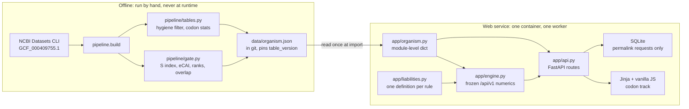
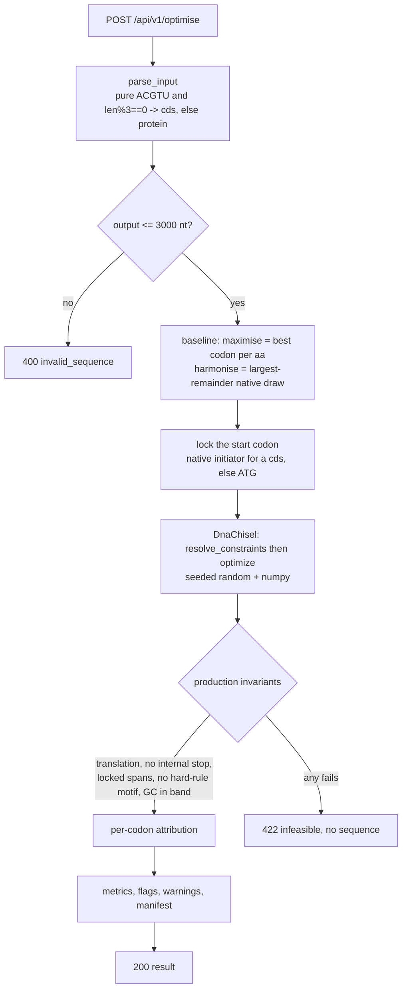
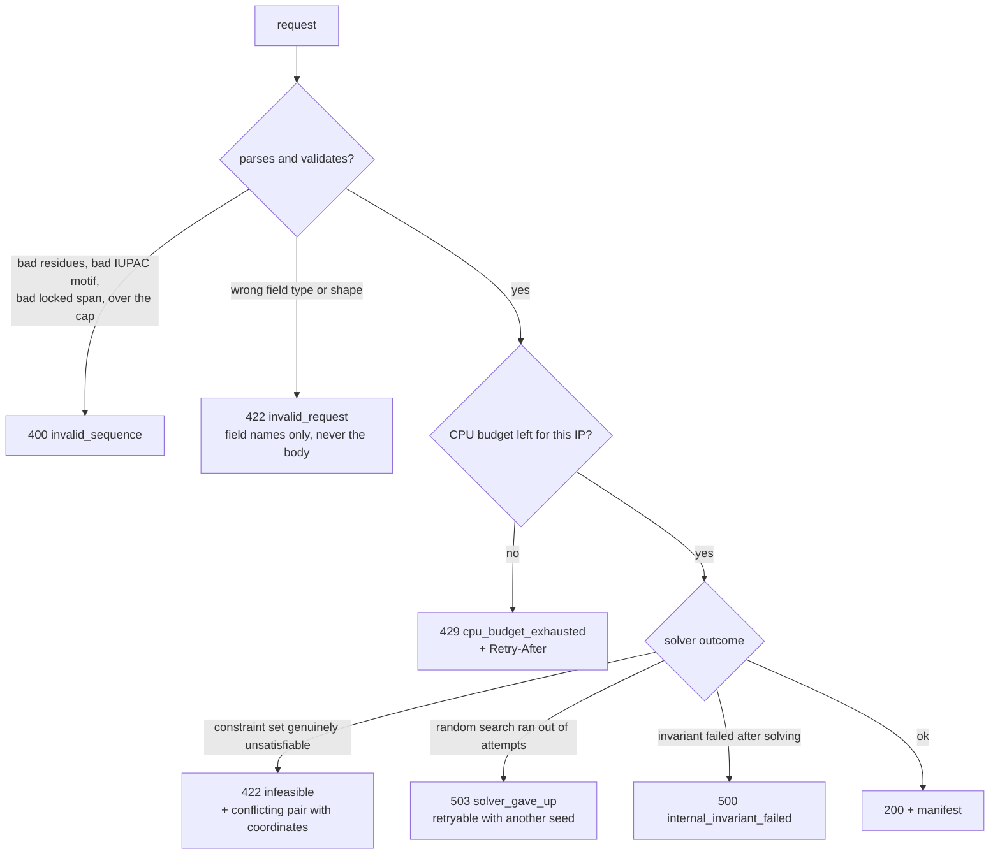
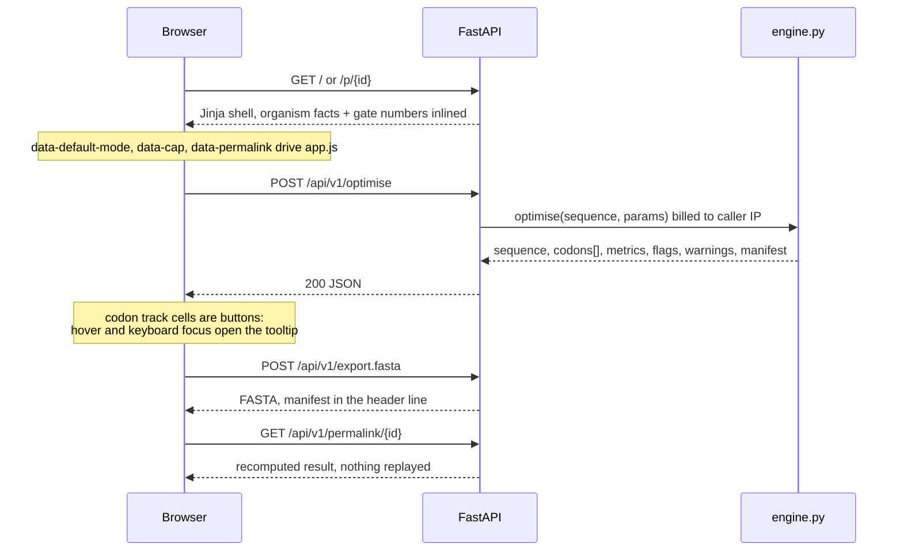
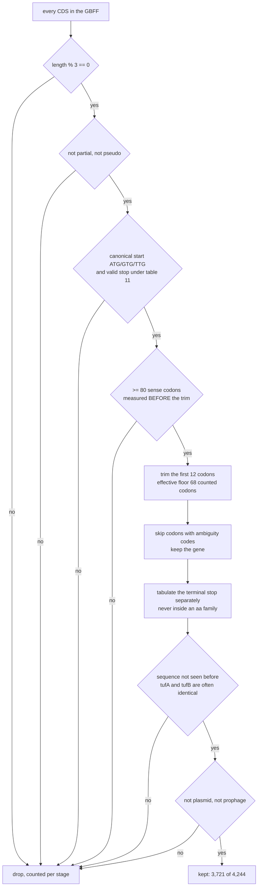
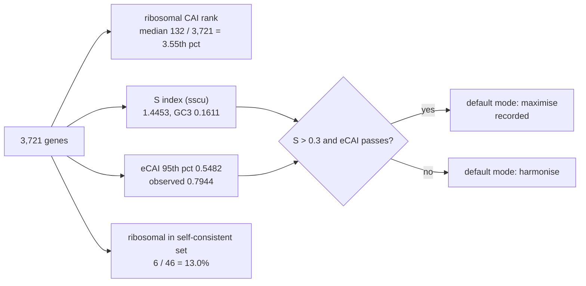

Codon Optimiser

Codon optimiser for **Clostridium butyricum DSM 10702** (RefSeq `GCF_000409755.1`,
taxid 1316931, NCBI translation table 11, 28.4992% genomic GC).

Paste a protein or a coding sequence, get a DNA coding sequence plus a per-codon
explanation of why each codon was chosen. The explanation is the product; the
sequence is commodity.

Every fixed convention is a module constant, not prose: the hygiene filter and the
table parameters in `pipeline/tables.py`, the liability rules in `app/liabilities.py`,
the bands and windows in `app/engine.py`. Each result echoes the whole set back in its
`manifest`, so the values a run actually used can never drift from the ones documented
here. This file says how the pieces fit and how to run them.

## How it fits together

Two halves that never blur. The pipeline is run by hand and writes one file; the
service reads that file at import and never touches the pipeline again.

`liabilities.py` holds each rule exactly once and is used three ways: to configure
the solver, to explain which rule forced a codon, and to assert in production that
the returned sequence violates nothing.

## Layout

    pipeline/   offline, run by hand, writes data/organism.json and stops
    app/        the web service: reads data/organism.json at import, nothing else
    data/       organism.json (in git); permalinks.sqlite (not in git)
    tests/      control, round-trip, determinism, API contracts

## What one request does

Per-codon attribution is a whole-sequence test, not a local one: the rejected codon
is put back and the *entire* sequence is rescanned, because a 20 bp direct repeat's
partner copy can sit anywhere. A local-window scan mislabels constraint-forced
codons as objective-driven.

## Failure modes, kept distinct

`NoSolutionError` after the random search exhausts its attempts is **not** proof of
infeasibility, so it never claims to be. Every refusal returns coordinates and no
sequence. Rate limiting is on CPU-seconds per IP (20 s per 60 s window), billed on
the worker thread that runs the solve, not on request count.

One thing deliberately degrades to a `warnings` entry instead of an error, because
the solve itself is fine and is the expensive part: a permalink row that cannot be
written (read-only or full disk — the result comes back without a shareable link).
In the browser, a failed Copy or FASTA export reports on the button that was pressed
and never clears the result underneath it.

## UI wiring

`GET /` is server-rendered so the organism facts and the four gate numbers are
readable before any JavaScript runs. Everything after that is one script against
`/api/v1`.

The codon track is the one component built by hand: 28x22px monospace cells,
background interpolated on the adaptiveness ramp, a 2px amber bottom bar for
`changed-by-constraint`, indigo for `changed-by-objective`, no bar for `unchanged`,
plus a "colour by change" view. Visual system comes from the Stitch design system
asset `assets/17898767070783141685` ("Instrument"); its `design.md` is the contract
`app/static/app.css` implements. Stitch screen generation is unusable through MCP: every
call dies on a 30 s transport timeout while the tool's own docs say generation takes
minutes, and the job does not survive the abort, so there are no screen mockups to
implement against and the layout follows the design system's documented rules.

## The tables, and the gate that decides the default mode

The hygiene filter runs in exactly this order; the order is the reason the numbers
are reproducible.

Then four numbers decide the tool's default mode.

All four are displayed in the UI. The low overlap in `R4` is expected here:
iterating from genome-wide weights climbs the AT-mutational gradient, not the
translational one. The E. coli control run gives 33/45 = 73%, which is what shows
the procedure itself is sound.

## Rebuild the tables (only when a fixed convention changes)

    curl -sL -o .tools/datasets https://ftp.ncbi.nlm.nih.gov/pub/datasets/command-line/v2/mac/datasets
    chmod +x .tools/datasets
    python -m pipeline.build GCF_000409755.1        # downloads via the Datasets CLI, then builds

It prints the Step 1 facts, the four Step 2 gate numbers and the new `table_version`.
Those are the recorded numbers: update the gate table above and the constants that
moved, because `table_version` is a hash of them and every manifest carries it.

## Run

    pip install -r requirements.txt
    uvicorn app.api:app --workers 1

    docker build -t codon-optimiser . && docker run -p 8000:8000 codon-optimiser

Then open <http://127.0.0.1:8000/>. Both forms must be started from the repository
root: the default table path is relative (`ORGANISM_JSON` overrides it).

## Tutorial: one sequence, start to finish

### In the page

**1. Paste a sequence.** Either a protein (`MSKIYA…`) or a coding sequence (`ATGAGC…`).
`parse_input` decides: pure ACGT/U with a length divisible by 3 is a CDS, anything else
is protein. A CDS costs nothing extra and buys two things — its own CAI for comparison,
and its native initiator is kept instead of a forced `ATG`. The cap is 3,000 nt of
*output*, checked against the protein length, not the paste. **Load example ribosomal
protein** fills in rpsJ (`K670_RS00880`) if you just want to see it move.

**2. Pick a mode.** Maximise gives every amino acid the reference set's favourite codon;
harmonise reproduces the genome-wide distribution, rare codons at their natural rate.
The default is what the gate decided — maximise for this organism. Rule of thumb:
maximise when you want the highest adaptation the liability rules allow, harmonise when
you want native-like behaviour and distrust CAI as a proxy.

**3. Name the motifs you cannot ship.** Restriction and Type IIS sites, comma separated:
`GAATTC, GGATCC, GGTCTC`. IUPAC codes work (`N R Y W S K M B D H V`), both strands are
checked, and the rule is hard — a returned sequence never contains one.

This field is not optional decoration. Maximising CAI *manufactures* these sites,
because the best codons here are `E → GAA` and `F → TTC`, so every **EF** in your protein
spells `GAATTC`, and every **HM** spells `CATATG`:

| run on a test protein with three EF pairs | CAI | EcoRI sites | codons forced by a constraint |
|---|---|---|---|
| no `avoid` | 0.8847 | 2 | 1 |
| `avoid = GAATTC` | 0.7840 | 0 | 3 |

That 0.10 of CAI is the honest price of a construct that survives its own cloning
reaction. The per-codon record names it: `E: GAA → GAG, avoided_motif, "GAA here would
create GAATTC"`.

**4. Leave the seed alone.** `20240517`. Same input plus same seed is byte-identical
output, which is what makes permalinks recomputable. Change it for exactly two reasons:
to redraw a harmonisation (the codon *counts* are arithmetic, only which position gets
which synonym is drawn), or to retry a `503 solver_gave_up`, which means the random
search ran out of attempts and is explicitly not a proof of infeasibility.

**5. Optimise.** Tick **Create permalink** first if you want a link — it stores the
request only, and `/p/{id}` recomputes the result on read.

### Reading the result

| What | How to read it |
|---|---|
| **CAI** | geometric mean of per-codon relative adaptiveness $w_c = f_c / \max f_{c'}$ over the family. 1.0 = the favourite codon everywhere. Met, Trp and stops have no synonym and are excluded. A pasted CDS also shows its own CAI |
| **GC** | the global band is hard. The 50nt window has a hard ceiling and a *flagged-only* floor — a 25% floor inside a 28.5%-GC organism forbids sequence its own ribosomal genes contain, and drove `rplB` infeasible |
| **Changed codons** | against your CDS, or against the mode's baseline for protein input. Recounted after codon 12, because the weights were built on genes trimmed there |
| **5′ ΔG** | MFE of the first 40 nt. Near zero means open, which is what initiation wants. Do not read a large negative number as "stable, therefore good" |
| **Codon track** | colour by adaptiveness, or by what moved each codon. Hover a codon for its weight, the rule that moved it and the local ΔG that choice cost |
| **Flags** | soft liabilities deliberately left in: AT-rich windows, hairpins, terminator-like stems. Nothing here is a hard-rule violation — those are never returned |
| **Warnings** | facts about the run, not the sequence: a non-M start, a permalink that could not be written |
| **Manifest** | every constant the run used. Travels into Copy and Export FASTA, so a result can be reproduced elsewhere |

A refusal is not a result. `422 infeasible` and `503 solver_gave_up` return coordinates
and the conflicting pair of rules, and **no sequence** — see the failure-mode diagram
above. `422` is also the request-validation status; the `error` field tells them apart
(`infeasible` vs `invalid_request`), and a bad sequence is `400 invalid_sequence`.

### The same thing over the API

    # optimise a protein, forbid two restriction sites, ask for a permalink
    curl -s localhost:8000/api/v1/optimise -H 'content-type: application/json' -d '{
      "sequence": "MSKQKIRIRLKAFDHTILDQSAEKIVETAKTSGAKVVGPVPLPTEKDVVTILRAVHKYKDSREQFEIRTHKRLIDIVNPSPKTVDALMRLNLPAGVDIEIKL",
      "mode": "maximise", "avoid": ["GAATTC", "GGATCC"], "permalink": true
    }' | jq '{sequence, cai: .metrics.cai, permalink, warnings}'

    # recompute a permalink; nothing but the request was stored
    curl -s localhost:8000/api/v1/permalink/32e478668be8b1df | jq '.metrics'

    # FASTA, manifest in the header line
    curl -s localhost:8000/api/v1/export.fasta -H 'content-type: application/json' \
      -d '{"sequence": "MSKIYAIAKELNVSKQTVSRWLNDESLSKEQ"}'

`locked` is API-only: `[[0, 12]]` holds codons 0–11 of a pasted CDS exactly as given while
everything downstream is optimised — the way to keep a tag, an RBS-adjacent 5′ end or a
fusion junction untouched. Spans are codon indices, half-open, and are asserted unchanged
before the response is built.

Budget note: the rate limit is 20 CPU-seconds per IP per 60 s, billed on the thread that
solves, so it is the *solve* you pay for and a health check costs nothing. Measured on an
M4: rpsJ (103 codons) 0.01 CPU-s, a 1,000-codon protein 0.16 in maximise and 1.20 in
harmonise, a repetitive 500-codon protein 0.56 before giving up. Ordinary use will not
reach the ceiling; a script in a loop will.

## API

| Route | Purpose |
|---|---|
| `GET /healthz` | engine and table version |
| `GET /api/v1/organism` | organism facts, the four gate numbers, codon tables, limits |
| `POST /api/v1/optimise` | `{sequence, mode?, seed?, avoid?, locked?, permalink?}` |
| `GET /api/v1/permalink/{id}` | recomputes a stored request (deterministic, so nothing but the request is stored) |
| `POST /api/v1/export.fasta` | FASTA with the manifest in the header line |

`locked` (codon-index spans held to the input) is API-only; the page exposes mode,
seed, avoided motifs and permalink.

Sequences live in memory for the request only. The single carve-out is
`permalink: true`, which stores the *request* — never the output — keyed by a hash
of request + engine + table version, and recomputes on read.

## Tests

    pytest

`tests/test_control.py` downloads `GCF_000005845.2` and the PaxDb E. coli
integrated dataset into `.work/` on first run (skips if the network or the
Datasets CLI is unavailable). It is the only test that catches a silent
hygiene-filter bug: current run gives Spearman rho = 0.588 over 3,560 genes.

The rest: round-trip (re-optimising native ribosomal genes must move few codons and
never de-adapt them), determinism (ten runs, byte-identical), engine contracts, and
API contracts including that no error response ever echoes a sequence.

CI runs the same command on every push (`.github/workflows/tests.yml`). It installs the
Datasets CLI first and caches `.work/`, because the control test skips itself without
that binary — and a control test that always skips is the requirement in name only.
